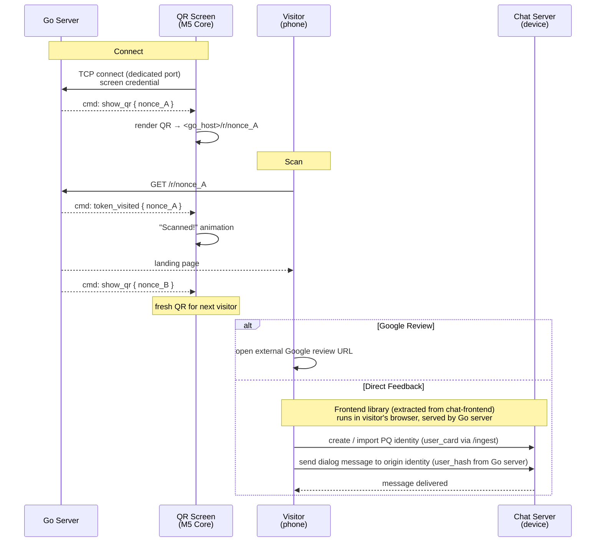

# PQ Review MVP — QR Flow

The end-to-end journey from a QR code on a screen to a completed Google review or a direct-feedback dialog message to the origin owner.

## Goal

A minimal, working review-collection flow for a physical location. An M5 Core Inc device (ESP32 microcontroller with built-in screen) displays a QR code. A visitor scans it, lands on a **Go server** page, and either leaves a Google review or sends a direct private message to the origin owner through the chat system. The screen refreshes to a new QR after each scan — giving the owner real-time feedback that someone engaged.

The **Go server** is a dedicated service that owns the public-facing QR flow: screen management and landing pages. Its internals are out of scope for this spec — it is treated as a black box. The landing page embeds a **frontend library** (extracted from `chat-frontend`) that handles PQ identity creation/import and dialog messaging directly against the chat server. The Go server's responsibility is to provide the landing page with the **target `user_hash`** — the origin identity the visitor should message.

---

## Actors

| Actor | Description |
|-------|-------------|
| **QR screen** | M5 Core Inc (ESP32 + display). A dumb display — provisioned with Go server host and a screen credential. The Go server knows which origin each screen belongs to. Communicates over TCP to receive display commands. |
| **Go server** | Black box. Manages QR screens (TCP protocol), generates and rotates nonces, serves the landing page. Knows the origin's `user_hash` and passes it to the frontend library. Internals out of scope. |
| **Chat server** | Phoenix backend (on device or central). Provides messaging infrastructure only — identity creation/import, dialog messaging, Electric sync. The frontend library on the Go server's landing page talks to it directly. |
| **Visitor** | Person at the physical location. Scans the QR with their phone camera. |

---

## Flow



---

## Step-by-step

### 1. M5 Core connects to the Go server

On boot, the M5 Core opens a persistent **TCP connection** to the Go server on a dedicated port. It sends its screen credential as a handshake. The Go server authenticates the screen, looks up which origin it belongs to, generates a nonce, and immediately pushes a `show_qr` command.

The M5 Core constructs the full URL from its provisioned `host` and the nonce, then renders it as a QR code.

The M5 Core is a **slave** — it never polls. It holds the TCP connection open and reacts to commands pushed by the Go server. On disconnect, it reconnects with exponential backoff.

### 2. Visitor scans the QR

The visitor's phone camera reads the QR code and opens `https://<go_host>/r/<nonce_A>` in the mobile browser.

### 3. Go server pushes scan event to the QR screen

On `GET /r/<nonce>`, before serving the landing page, the Go server sends a `token_visited` command to the M5 Core connected for that origin (over the existing TCP connection).

The M5 Core shows visual feedback (animation, "Someone scanned!", sound, etc.). After the animation, the Go server pushes `show_qr` with a **fresh nonce** (`nonce_B`) — so the next visitor always gets a clean, unvisited link.

### 4. Landing page — the choice

The Go server renders a landing page at `/r/<nonce>` with two options:

| Option | Action |
|--------|--------|
| **Google Review** | External redirect to the origin's Google review URL (configured per origin). Quick path — no identity needed. |
| **Direct Feedback** | Starts the PQ identity flow via the frontend library. The message goes to the origin owner as a chat dialog. |

The landing page shows the origin's name and optionally a brief context ("Tell us about your experience" / origin-customizable greeting).

**If no Google review URL is configured**, only the direct feedback option is shown.

### 5. Identity creation / import (direct feedback path)

If the visitor chooses "Direct feedback", the **frontend library** (extracted from `chat-frontend`) handles identity creation/import and PoP entirely in the visitor's browser. The library talks directly to the chat server — the Go server is not involved in identity or messaging.

The library's identity flow (keypair generation, `/ingest`, PoP, local storage reuse) is out of scope for this spec.

### 6. Send dialog message

After identity is established, the frontend library:

1. Opens a dialog with the origin identity — the Go server provides the target `user_hash` to the page
2. The visitor composes and sends their feedback message
3. The message is delivered to the origin identity as a regular encrypted dialog message

The origin owner sees the feedback in their chat — same as any other dialog message. No separate review pipeline for this path.

### 7. Confirmation

The visitor sees message-delivered confirmation on the same page. The conversation persists as a regular dialog — the visitor and origin owner can continue the exchange if needed.

---

## QR Screen — M5 Core Inc

The QR screen is an **M5 Core Inc** device — an ESP32-based microcontroller with a built-in color display. It runs standalone firmware (not Phoenix/LiveView) and communicates with the **Go server** over TCP.

### Provisioning

The M5 Core is provisioned with these values (flashed or configured via BLE/serial):

| Value | Purpose |
|-------|---------|
| `screen_credential` | Opaque token that identifies this screen to the Go server. The Go server maintains the screen → origin mapping. |
| `host` | Go server base URL. The M5 Core constructs QR URLs from it. |

These are stored in the M5 Core's non-volatile storage (NVS). The screen has no knowledge of origins — it only displays what the Go server tells it.

### Boot sequence

1. Connect to WiFi (credentials in NVS)
2. Open TCP connection to `<host>:<screen_port>`
3. Send handshake: `screen_credential`
4. Wait for commands from the Go server

On disconnect — reconnect with exponential backoff. On reconnect the Go server re-sends the current state (e.g. `show_qr` with the active nonce).

### Commands (Go server → M5 Core)

The M5 Core is a **slave** — it never requests data. The Go server pushes commands over the persistent TCP connection. The M5 Core renders accordingly.

| Command | Payload | M5 Core behavior |
|---------|---------|-------------------|
| `show_qr` | `{ nonce }` | Render QR code from host + nonce. Idle state. |
| `token_visited` | `{ nonce }` | Show "Scanned!" animation / sound. Returns to previous state after a few seconds. |
| `standby` | — | Show waiting screen ("Setting up..."). No pending token available yet. |
| `error` | `{ message }` | Show error message. |

Future commands (post-MVP): `show_stats`, `update_branding`, `firmware_update_available`.

### Screen states

| State | Trigger | Display |
|-------|---------|---------|
| **QR idle** | `show_qr` command | QR code + origin branding + call-to-action |
| **Scanned** | `token_visited` command | Brief animation / sound, auto-returns to QR idle |
| **Standby** | `standby` command or no nonce on connect | "Setting up..." / waiting screen |
| **Disconnected** | TCP connection lost | "No connection" — reconnecting |

### Token rotation

Every scan triggers rotation — after `token_visited`, the Go server generates a fresh nonce and pushes `show_qr` with it to the M5 Core. This way each visitor sees a unique link, even if the previous visitor hasn't finished their flow yet.

### Screen auth

The `screen_credential` is a Go-server-issued opaque token. The Go server maintains the mapping from credential to `(origin_hash, screen_id)`. The origin owner creates screen credentials from the Go server's admin UI.

For the MVP, a simple random token stored in the Go server's database is sufficient. No PQ signature chain needed — the screen is a display-only peripheral, not a PQ participant.

---

## Screen TCP Protocol

The M5 Core communicates over a **dedicated TCP port** on the Go server (not HTTP).

### Handshake (M5 Core → Go server, once per connection)

```
<screen_credential>\n
```

Go server validates the credential, looks up which origin this screen belongs to, and associates this TCP socket with it. On success, the server immediately pushes the current state (`show_qr` or `standby`). On failure, the server sends `error` and closes the connection.

### Message framing

Newline-delimited JSON, one command per line:

```
{"cmd":"show_qr","nonce":"<nonce_A>"}\n
{"cmd":"token_visited","nonce":"<nonce_A>"}\n
{"cmd":"standby"}\n
```

The M5 Core only reads — it never sends data after the handshake (slave mode). The Go server sends periodic `{"cmd":"ping"}\n` as keepalive; the M5 Core may respond with `{"cmd":"pong"}\n` to confirm liveness (optional — the server can detect dead connections via TCP keepalive or write failures).

---

## Landing Page ↔ Chat Server Interface

The chat server's only role is **messaging infrastructure** — identity and dialogs. The Go server handles everything else (QR flow, nonces, screens, landing pages). The Go server is a black box; its internals are out of scope.

### Go server provides to the landing page

| Data | Purpose |
|------|---------|
| `user_hash` (origin identity) | The frontend library needs to know who the visitor should message |
| `google_review_url` | External Google review link (if configured) |
| `origin_name` / greeting | Display context for the landing page |

How the Go server obtains this data (Electric subscription, REST, config file) is its own concern. It needs the origin's `user_hash` — obtaining it is a Go server setup / provisioning concern, not a chat server endpoint.

### Frontend library ↔ Chat server (browser → chat server directly)

The frontend library is a standalone JS library **extracted from `chat-frontend`** that handles PQ identity and dialog messaging. It is served by the Go server as static JS and talks directly to the chat server — the Go server does not proxy or intercept the traffic.

The library's scope (identity creation/import, PoP, dialog send/read, Electric shape subscription) and packaging are out of scope for this spec.

---

## Landing Page Behavior by Nonce State

| Nonce state | Visitor | Page shows |
|-------------|---------|------------|
| **active** | anyone | Choice: Google review / Direct feedback |
| **visited** | anyone | "This link was already scanned" + origin info (can still choose) |
| **not found** | anyone | 404 |

Nonce states are a Go server concern — it generates, tracks, and rotates them independently. The chat server has no knowledge of nonces.

---

## What This Spec Does NOT Cover

- **M5 Core firmware** — the ESP32 firmware for the M5 Core (WiFi, QR rendering, TCP client, NVS storage) is out of scope. This spec defines the Go server-side protocol it talks to.
- **M5 Core provisioning UX** — how the owner flashes `screen_credential` + WiFi credentials onto the M5 Core (BLE setup app, serial, QR-based provisioning) is deferred.
- **Go server internals** — the Go server is a black box. Its implementation, deployment, and infrastructure are out of scope.
- **Frontend library packaging** — extraction scope, npm package vs build-time extract, and the library's internal API are out of scope.
- **Full review pipeline** — the direct-feedback path sends a dialog message, not a review through the moderation pipeline. Review pipeline integration is a future enhancement.
- **Google review URL validation** — the URL is stored as-is; the landing page opens it in a new tab.

---

## Implementation Phases

### Phase 1 — Landing page + Google redirect

- [ ] Go server serves landing page for scanned nonces
- [ ] Landing page shows origin name, greeting, and choice (Google review / Direct feedback)
- [ ] Google review button opens external URL in new tab
- [ ] If no Google URL configured: show only Direct feedback

### Phase 2 — M5 Core screen protocol

- [ ] Go server TCP listener for M5 Core connections
- [ ] Handshake: validate `screen_credential`, resolve screen → origin
- [ ] Push `show_qr` / `standby` / `token_visited` commands over TCP
- [ ] Token rotation: after visit, push fresh nonce
- [ ] Periodic `ping` keepalive, dead connection cleanup

### Phase 3 — Direct feedback flow

- [ ] Embed frontend library in Go server's landing page (library extraction is out of scope for this spec)
- [ ] Go server provides target `user_hash` (origin identity) to the page
- [ ] Visitor creates/imports identity → sends dialog message → confirmation
- [ ] End-to-end test: scan → identity → dialog message delivered to origin owner

---

## Open Questions

1. **Google review tracking.** Should we track when a visitor chooses the Google redirect? A simple counter per origin in the Go server, or is the screen scan notification enough for the owner?

2. **Anonymous feedback.** Should there be a third option — anonymous text feedback that doesn't require PQ identity? Simpler than identity creation, but loses the dialog/reply benefits.

3. **Screen credential issuance.** Who creates the screen's credential — the Go server automatically, or the owner manually from the Go server's admin UI? How many screens per origin?

4. **Rate limiting.** The landing page is publicly accessible. Should we rate-limit `GET /r/:nonce` to prevent scan-notification spam on the M5 Core?

5. **TCP keepalive interval.** The M5 Core is on WiFi with possible intermittent connectivity. What's the right `ping` interval? Should the Go server require a `pong` response, or rely on TCP-level keepalive / write failure detection?

6. **TCP port number.** What port should the Go server's TCP listener run on? Fixed or configurable via env?

7. **TLS on TCP.** Should the screen TCP connection use TLS? The M5 Core has limited resources — plain TCP with the `authtoken` might be sufficient for MVP, with TLS as a later hardening step.

---

## Status

Proposed.

## References

- [pq_origin](pq_origin.done.md) — origin entity
- [pq_origin_settings](pq_origin_settings.proposed.md) — per-origin key-value settings (Google review URL, greeting)
- [pq_reviews](pq_reviews.in_progress.md) — review pipeline, moderation (future integration)
- [pq_review_contacts](pq_review_contacts.done.md) — contacts channel, review list
