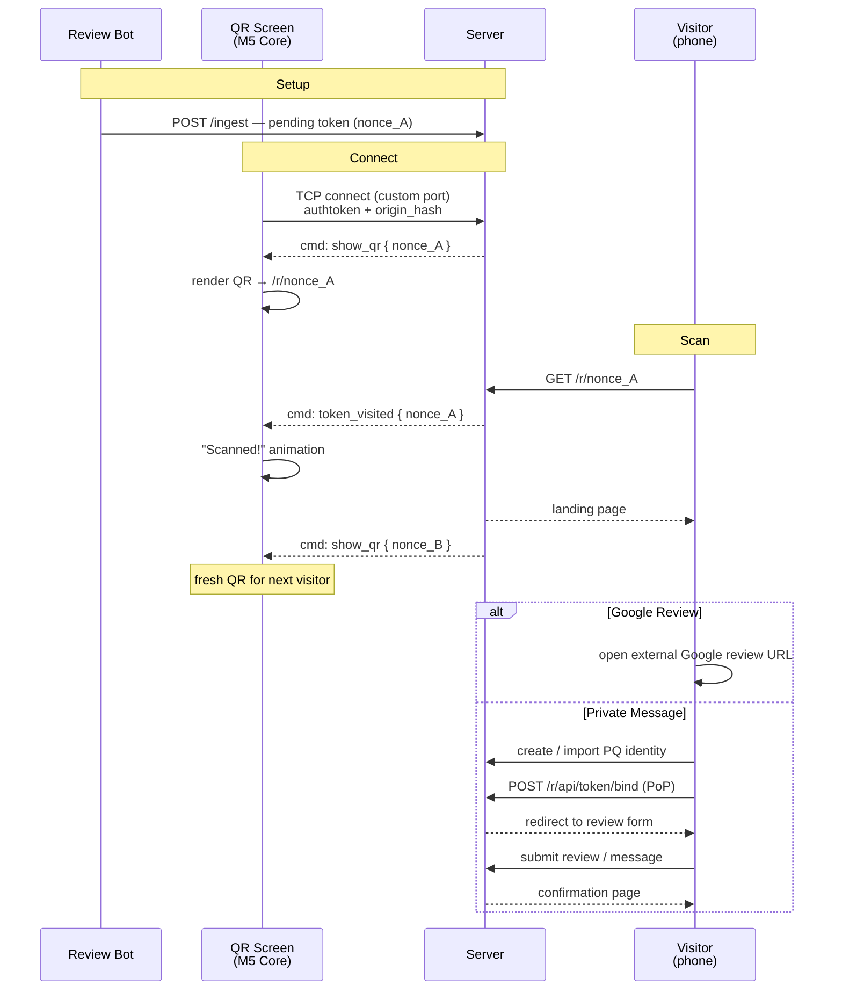

# PQ Review MVP — QR Flow

The end-to-end journey from a QR code on a screen to a completed review or private message.

## Goal

A minimal, working review-collection flow for a physical location. An M5 Core Inc device (ESP32 microcontroller with built-in screen) displays a QR code. A visitor scans it, lands on a server page, and either leaves a Google review or sends a private message to the origin owner. The screen refreshes to a new QR after each scan — giving the owner real-time feedback that someone engaged.

---

## Actors

| Actor | Description |
|-------|-------------|
| **Review bot** | Per-origin bot identity ([pq_review_write_tokens](pq_review_write_tokens.in_progress.md#review-bot-identity)). Runs on the Nerves device (or any device holding origin keys). Generates tokens, observes binds. |
| **QR screen** | M5 Core Inc (ESP32 + display). Provisioned with `origin_hash` and an `authtoken`. Communicates with the server over HTTP to fetch nonces and receive scan notifications. |
| **Visitor** | Person at the physical location. Scans the QR with their phone camera. |
| **Server** | Phoenix backend. Serves the landing page, handles token state transitions, pushes events to the QR screen. |

---

## Flow



---

## Step-by-step

### 1. Bot creates a pending token

The review bot creates a pending token and ingests it to the server via `POST /ingest`. The token is now in the `review_write_tokens` table, queryable by the server.

Token state: **pending** (`user_hash = null`, `review_hash = null`).

The bot creates new pending tokens on demand — each scan consumes one nonce and the server requests a fresh one for the next visitor.

### 2. M5 Core connects to the server

On boot, the M5 Core opens a persistent **TCP connection** to the server on a dedicated port. It sends its `authtoken` and `origin_hash` as a handshake. The server authenticates the screen, looks up the current pending reusable token for that origin, and immediately pushes a `show_qr` command with the nonce.

The M5 Core constructs the full URL (`https://<host>/r/<nonce>`) from its provisioned `host` and renders it as a QR code.

If no pending token exists for that origin, the server pushes a `standby` command — the M5 Core shows a waiting screen. When a token becomes available later (bot ingests one), the server pushes `show_qr` automatically.

The M5 Core is a **slave** — it never polls. It holds the TCP connection open and reacts to commands pushed by the server. On disconnect, it reconnects with exponential backoff.

### 3. Visitor scans the QR

The visitor's phone camera reads the QR code and opens `https://<host>/r/<nonce_A>` in the mobile browser.

### 4. Server pushes scan event to the QR screen

On `GET /r/<nonce>`, before serving the landing page, the server publishes `{:token_visited, nonce}` on PubSub topic `"review_token:<origin_hash>"`. The TCP connection handler for that origin's M5 Core picks this up and pushes a `token_visited` command over the open TCP connection.

The M5 Core shows visual feedback (animation, "Someone scanned!", sound, etc.). After the animation, the server pushes `show_qr` with a **fresh nonce** (`nonce_B`) — so the next visitor always gets a clean, unvisited link.

### 5. Landing page — the choice

The server renders a landing page at `/r/<nonce>` with two options:

| Option | Action |
|--------|--------|
| **Google Review** | External redirect to the origin's Google review URL (stored in `origin_settings` key `google_review_url`). Quick path — no identity needed. |
| **Private Message** | Starts the PQ identity flow. The message goes directly to the origin owner, encrypted and private. |

The landing page shows the origin's name and optionally a brief context ("Tell us about your experience" / origin-customizable greeting from `origin_settings` key `review_greeting`).

**If no `google_review_url` is configured**, only the private message option is shown.

### 6. Identity creation / import (private message path)

If the visitor chooses "Private message":

1. If the visitor has no PQ identity — create one (keypair generation in-browser, `user_cards` row via `/ingest`)
2. If the visitor already has a PQ identity (cookie / local storage) — reuse it
3. Visitor proves possession (PoP) — signs a challenge with their `sign_skey`

This reuses the existing identity creation flow from `chat-frontend`.

### 7. Bind token + send message

After identity is established:

1. `POST /r/api/token/bind` — binds `user_hash` to the token (or creates a bound copy for reusable tokens). Review bot issues vouch tokens for the reviewer (origin gate + device gate). See [Token bind](pq_review_write_tokens.in_progress.md#token-bind).
2. Visitor writes and submits their message/review through the standard review form.
3. The review enters the origin's pipeline per its `moderation_mode`.

### 8. Confirmation

Visitor sees a confirmation page. The bound token is now a permanent link — if the visitor returns to `/r/<their_nonce>`, they see their review (view/edit).

---

## QR Screen — M5 Core Inc

The QR screen is an **M5 Core Inc** device — an ESP32-based microcontroller with a built-in color display. It runs standalone firmware (not Phoenix/LiveView) and communicates with the server over HTTP.

### Provisioning

The M5 Core is provisioned with these values (flashed or configured via BLE/serial):

| Value | Purpose |
|-------|---------|
| `origin_hash` | Identifies which origin this screen belongs to — sent on every API call so the server knows which bot to target |
| `authtoken` | Bearer token for the screen API endpoints. Issued by the origin owner (see [Screen auth](#screen-auth)). |
| `host` | Server base URL (e.g. `https://example.com`). The M5 Core constructs QR URLs as `<host>/r/<nonce>`. |

These are stored in the M5 Core's non-volatile storage (NVS).

### Boot sequence

1. Connect to WiFi (credentials in NVS)
2. Open TCP connection to `<host>:<screen_port>`
3. Send handshake: `authtoken` + `origin_hash`
4. Wait for commands from the server

On disconnect — reconnect with exponential backoff. On reconnect the server re-sends the current state (e.g. `show_qr` with the active nonce).

### Commands (server → M5 Core)

The M5 Core is a **slave** — it never requests data. The server pushes commands over the persistent TCP connection. The M5 Core renders accordingly.

| Command | Payload | M5 Core behavior |
|---------|---------|-------------------|
| `show_qr` | `{ nonce }` | Render QR code for `<host>/r/<nonce>`. Idle state. |
| `token_visited` | `{ nonce }` | Show "Scanned!" animation / sound. Returns to previous state after a few seconds. |
| `standby` | — | Show waiting screen ("Setting up..."). No pending token available yet. |
| `error` | `{ message }` | Show error message. |

Future commands (post-MVP): `show_stats`, `update_branding`, `firmware_update_available`.

### Screen states

| State | Trigger | Display |
|-------|---------|---------|
| **QR idle** | `show_qr` command | QR code + origin branding + call-to-action |
| **Scanned** | `token_visited` command | Brief animation / sound, auto-returns to QR idle |
| **Standby** | `standby` command or no nonce on connect | "Setting up..." / waiting screen |
| **Disconnected** | TCP connection lost | "No connection" — reconnecting |

### Token rotation

Every scan triggers rotation — after `token_visited`, the server pushes `show_qr` with a fresh nonce. The server asks the review bot (via PubSub or direct call) to create a new pending token, then pushes it to the M5 Core. This way each visitor sees a unique link, even if the previous visitor hasn't finished their flow yet.

### Screen auth

The `authtoken` is a server-issued opaque token tied to `(origin_hash, screen_id)`. The origin owner generates it from the admin UI (or the review bot issues it). The server validates it during the TCP handshake and associates the connection with the origin.

For the MVP, a simple random token stored in a `screen_tokens` server-side table (or an `origin_settings` key) is sufficient. No PQ signature chain needed — the screen is a display-only peripheral, not a PQ participant.

---

## New Origin Settings

| Key | Values | Default | Purpose |
|-----|--------|---------|---------|
| `google_review_url` | URL string | `null` (not set) | External Google review link. When absent, landing page shows only the private message option. |
| `review_greeting` | Text | `null` (not set) | Optional greeting shown on the landing page ("How was your visit?"). Falls back to a generic default. |

These live in the [`origin_settings`](pq_origin_settings.proposed.md) table.

---

## Screen TCP Protocol

Existing HTTP routes (`GET /r/:nonce`, `POST /r/api/token/create`, `POST /r/api/token/bind`) are defined in [pq_review_write_tokens](pq_review_write_tokens.in_progress.md#endpoints).

The M5 Core communicates over a **dedicated TCP port** (not HTTP). The server runs a `ScreenListener` (Ranch/Thousand Island acceptor) on this port.

### Handshake (M5 Core → server, once per connection)

```
<authtoken>\n<origin_hash>\n
```

Server validates the token, looks up the origin, and associates this TCP socket with `origin_hash`. On success, the server immediately pushes the current state (`show_qr` or `standby`). On failure, the server sends `error` and closes the connection.

### Message framing

Newline-delimited JSON, one command per line:

```
{"cmd":"show_qr","nonce":"<nonce_A>"}\n
{"cmd":"token_visited","nonce":"<nonce_A>"}\n
{"cmd":"standby"}\n
```

The M5 Core only reads — it never sends data after the handshake (slave mode). The server sends periodic `{"cmd":"ping"}\n` as keepalive; the M5 Core may respond with `{"cmd":"pong"}\n` to confirm liveness (optional — the server can detect dead connections via TCP keepalive or write failures).

---

## Landing Page Behavior by Token State

| Token state | Visitor | Page shows |
|-------------|---------|------------|
| **pending** | anyone | Choice: Google review / Private message |
| **bound** | same user | Review form (continue writing) or view existing review |
| **bound** | different user | "This link is already in use" (one-time) or new bind (reusable parent) |
| **reviewed** | same user | View/edit review |
| **reviewed** | different user | "This link is already in use" (one-time only) |
| **soft-deleted** | anyone | "This link has expired" |
| **not found** | anyone | 404 |

---

## What This Spec Does NOT Cover

- **Order-linked tokens** — MVP uses reusable tokens only. Order integration comes later.
- **QR printing / NFC** — Phase 3 of [pq_review_write_tokens](pq_review_write_tokens.in_progress.md#phase-3--qr).
- **M5 Core firmware** — the ESP32 firmware for the M5 Core (WiFi, QR rendering, TCP client, NVS storage) is out of scope. This spec defines the server-side protocol it talks to.
- **M5 Core provisioning UX** — how the owner flashes `origin_hash` + `authtoken` + WiFi credentials onto the M5 Core (BLE setup app, serial, QR-based provisioning) is deferred.
- **Review bot creation flow** — covered in [pq_review_write_tokens: Origin Admin UI](pq_review_write_tokens.in_progress.md#origin-admin-ui-enable-review-invitations).
- **Vouch chain details** — covered in [pq_review_write_tokens: Trust Delegation](pq_review_write_tokens.in_progress.md#trust-delegation).
- **Google review URL validation** — the URL is stored as-is; the frontend opens it in a new tab.

---

## Implementation Phases

### Phase 1 — Landing page + Google redirect

- [ ] `GET /r/:nonce` serves a landing page (not just a redirect)
- [ ] Landing page reads `google_review_url` from `origin_settings`
- [ ] If Google URL exists: show both options (Google review + Private message)
- [ ] If no Google URL: show only Private message
- [ ] Google review button opens external URL in new tab
- [ ] PubSub publish `{:token_visited, nonce}` on `"review_token:<origin_hash>"` when nonce is visited

### Phase 2 — M5 Core screen protocol

- [ ] `ScreenListener` — TCP acceptor on dedicated port (Ranch or Thousand Island)
- [ ] Handshake: validate `authtoken` + `origin_hash`, associate socket with origin
- [ ] Screen auth: `screen_tokens` table or `origin_settings` key — opaque token per screen
- [ ] `ScreenConnection` GenServer per connected screen — subscribes to PubSub `"review_token:<origin_hash>"`, pushes commands over TCP
- [ ] On connect: look up pending nonce, push `show_qr` or `standby`
- [ ] On `{:token_visited, nonce}` PubSub event: push `token_visited` command
- [ ] Periodic `ping` keepalive, dead connection cleanup
- [ ] Origin admin UI: "Generate screen token" action
- [ ] `review_greeting` support in `origin_settings`

### Phase 3 — Private message flow

- [ ] Identity creation/import on landing page (reuse `chat-frontend` identity flow)
- [ ] Token bind via `POST /r/api/token/bind`
- [ ] Review/message submission through standard pipeline
- [ ] Confirmation page with permanent link

---

## Open Questions

1. **Google review tracking.** Should we track when a visitor chooses the Google redirect? A simple counter in `origin_settings` or a separate analytics row? Or is the SSE scan notification enough for the owner?

2. **Anonymous feedback.** Should there be a third option — anonymous text feedback that doesn't require PQ identity? Simpler than identity creation, but loses the permanent-link and edit-later benefits.

3. **Screen token issuance.** Who creates the screen's `authtoken` — the review bot (as part of "enable invitations"), or the owner manually from the admin UI? How many screens per origin? Should the token be rotatable?

4. **Rate limiting.** The landing page is publicly accessible. Should we rate-limit `GET /r/:nonce` to prevent SSE notification spam on the M5 Core?

5. **TCP keepalive.** The M5 Core is on WiFi with possible intermittent connectivity. What's the right `ping` interval? Should the server require a `pong` response, or rely on TCP-level keepalive / write failure detection?

6. **TCP port number.** What port should the `ScreenListener` run on? Fixed (e.g. 4445, next to Phoenix on 4444) or configurable via env?

7. **TLS on TCP.** Should the screen TCP connection use TLS? The M5 Core has limited resources — plain TCP with the `authtoken` might be sufficient for MVP, with TLS as a later hardening step.

---

## Status

Proposed.

## References

- [pq_review_write_tokens](pq_review_write_tokens.in_progress.md) — token lifecycle, schema, endpoints, trust delegation
- [pq_origin_settings](pq_origin_settings.proposed.md) — per-origin key-value settings
- [pq_reviews](pq_reviews.in_progress.md) — review pipeline, moderation
- [pq_review_contacts](pq_review_contacts.done.md) — contacts channel, review list
- [pq_origin](pq_origin.done.md) — origin entity
