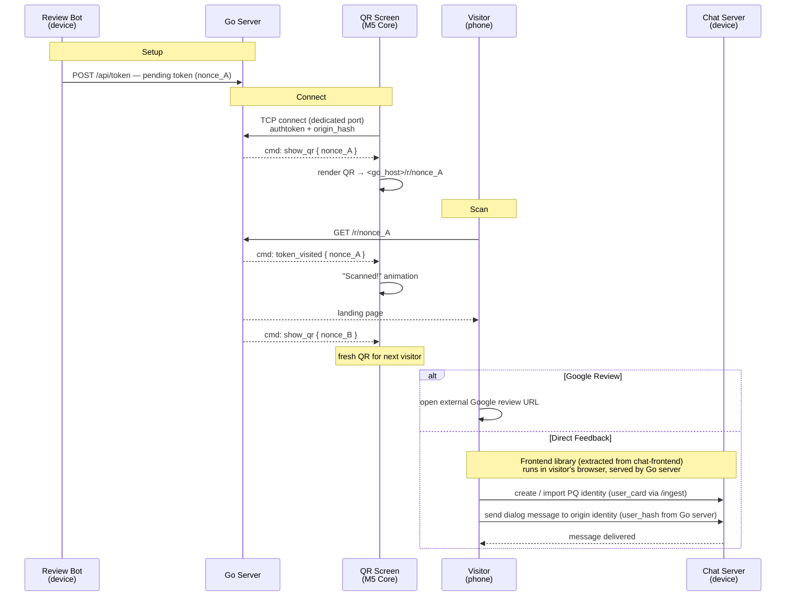

# PQ Review MVP — QR Flow

The end-to-end journey from a QR code on a screen to a completed Google review or a direct-feedback dialog message to the origin owner.

## Goal

A minimal, working review-collection flow for a physical location. An M5 Core Inc device (ESP32 microcontroller with built-in screen) displays a QR code. A visitor scans it, lands on a **Go server** page, and either leaves a Google review or sends a direct private message to the origin owner through the chat system. The screen refreshes to a new QR after each scan — giving the owner real-time feedback that someone engaged.

The **Go server** is a dedicated service that owns the public-facing QR flow: screen management and landing pages. Its internals are out of scope for this spec — it is treated as a black box. The landing page embeds a **frontend library** (extracted from `chat-frontend`) that handles PQ identity creation/import and dialog messaging directly against the chat server. The Go server's responsibility is to provide the landing page with the **target `user_hash`** — the origin identity the visitor should message.

---

## Actors

| Actor | Description |
|-------|-------------|
| **Review bot** | Per-origin bot identity ([pq_review_write_tokens](pq_review_write_tokens.in_progress.md#review-bot-identity)). Runs on the Nerves device. Creates pending tokens, observes binds. |
| **QR screen** | M5 Core Inc (ESP32 + display). Provisioned with `origin_hash` and an `authtoken`. Communicates with the **Go server** over TCP to receive nonces and scan notifications. |
| **Go server** | Black box. Manages QR screens (TCP protocol), serves the landing page. Knows the origin's `user_hash` and passes it to the frontend library. Internals out of scope. |
| **Chat server** | Phoenix backend (on device or central). Provides `/ingest`, Electric shapes, and dialog endpoints. The frontend library on the Go server's landing page talks to it directly. |
| **Visitor** | Person at the physical location. Scans the QR with their phone camera. |

---

## Flow



---

## Step-by-step

### 1. Bot creates a pending token

The review bot creates a pending token and sends it to the Go server via `POST /api/token`. The Go server stores the nonce, associating it with the origin.

Token state: **pending** (no visitor bound yet).

The bot creates new pending tokens on demand — each scan consumes one nonce and the Go server requests a fresh one for the next visitor.

### 2. M5 Core connects to the Go server

On boot, the M5 Core opens a persistent **TCP connection** to the Go server on a dedicated port. It sends its `authtoken` and `origin_hash` as a handshake. The Go server authenticates the screen, looks up the current pending nonce for that origin, and immediately pushes a `show_qr` command with the nonce.

The M5 Core constructs the full URL from its provisioned `host` and the nonce, then renders it as a QR code.

If no pending token exists for that origin, the Go server pushes a `standby` command — the M5 Core shows a waiting screen. When a token becomes available later (bot posts one), the Go server pushes `show_qr` automatically.

The M5 Core is a **slave** — it never polls. It holds the TCP connection open and reacts to commands pushed by the Go server. On disconnect, it reconnects with exponential backoff.

### 3. Visitor scans the QR

The visitor's phone camera reads the QR code and opens `https://<go_host>/r/<nonce_A>` in the mobile browser.

### 4. Go server pushes scan event to the QR screen

On `GET /r/<nonce>`, before serving the landing page, the Go server sends a `token_visited` command to the M5 Core connected for that origin (over the existing TCP connection).

The M5 Core shows visual feedback (animation, "Someone scanned!", sound, etc.). After the animation, the Go server pushes `show_qr` with a **fresh nonce** (`nonce_B`) — so the next visitor always gets a clean, unvisited link.

### 5. Landing page — the choice

The Go server renders a landing page at `/r/<nonce>` with two options:

| Option | Action |
|--------|--------|
| **Google Review** | External redirect to the origin's Google review URL (configured per origin). Quick path — no identity needed. |
| **Direct Feedback** | Starts the PQ identity flow on the Go server. The message goes to the origin owner as a chat dialog. |

The landing page shows the origin's name and optionally a brief context ("Tell us about your experience" / origin-customizable greeting).

**If no Google review URL is configured**, only the direct feedback option is shown.

### 6. Identity creation / import (direct feedback path)

If the visitor chooses "Direct feedback":

1. If the visitor has no PQ identity — create one (keypair generation in-browser, `user_cards` row via `/ingest` to the chat server)
2. If the visitor already has a PQ identity (cookie / local storage) — reuse it
3. Visitor proves possession (PoP) — signs a challenge with their `sign_skey`

All of this runs in the **frontend library** (extracted from `chat-frontend`) embedded in the Go server's landing page. The library talks directly to the chat server — the Go server is not involved in identity or messaging.

### 7. Send dialog message

After identity is established, the frontend library:

1. Opens a dialog with the origin identity — the Go server provides the target `user_hash` to the page
2. The visitor composes and sends their feedback message
3. The message is delivered to the origin identity as a regular encrypted dialog message

The origin owner sees the feedback in their chat — same as any other dialog message. No separate review pipeline for this path.

### 8. Confirmation

The visitor sees message-delivered confirmation on the same page. The conversation persists as a regular dialog — the visitor and origin owner can continue the exchange if needed.

---

## QR Screen — M5 Core Inc

The QR screen is an **M5 Core Inc** device — an ESP32-based microcontroller with a built-in color display. It runs standalone firmware (not Phoenix/LiveView) and communicates with the **Go server** over TCP.

### Provisioning

The M5 Core is provisioned with these values (flashed or configured via BLE/serial):

| Value | Purpose |
|-------|---------|
| `origin_hash` | Identifies which origin this screen belongs to — sent on every API call so the Go server knows which origin to target |
| `authtoken` | Bearer token for the screen. Issued by the origin owner (see [Screen auth](#screen-auth)). |
| `host` | Go server base URL. The M5 Core constructs QR URLs from it. |

These are stored in the M5 Core's non-volatile storage (NVS).

### Boot sequence

1. Connect to WiFi (credentials in NVS)
2. Open TCP connection to `<host>:<screen_port>`
3. Send handshake: `authtoken` + `origin_hash`
4. Wait for commands from the Go server

On disconnect — reconnect with exponential backoff. On reconnect the Go server re-sends the current state (e.g. `show_qr` with the active nonce).

### Commands (Go server → M5 Core)

The M5 Core is a **slave** — it never requests data. The Go server pushes commands over the persistent TCP connection. The M5 Core renders accordingly.

| Command | Payload | M5 Core behavior |
|---------|---------|-------------------|
| `show_qr` | `{ nonce }` | Render QR code from host + nonce. Idle state. |
| `token_visited` | `{ nonce }` | Show "Scanned!" animation / sound. Returns to previous state after a few seconds. |
| `standby` | — | Show waiting screen ("Setting up..."). No pending token available yet. |
| `error` | `{ message }` | Show error message. |

Future commands (post-MVP): `show_stats`, `update_branding`, `firmware_update_available`.

### Screen states

| State | Trigger | Display |
|-------|---------|---------|
| **QR idle** | `show_qr` command | QR code + origin branding + call-to-action |
| **Scanned** | `token_visited` command | Brief animation / sound, auto-returns to QR idle |
| **Standby** | `standby` command or no nonce on connect | "Setting up..." / waiting screen |
| **Disconnected** | TCP connection lost | "No connection" — reconnecting |

### Token rotation

Every scan triggers rotation — after `token_visited`, the Go server pushes `show_qr` with a fresh nonce. The Go server requests the review bot (or draws from a pre-created pool) to create a new pending token, then pushes it to the M5 Core. This way each visitor sees a unique link, even if the previous visitor hasn't finished their flow yet.

### Screen auth

The `authtoken` is a Go-server-issued opaque token tied to `(origin_hash, screen_id)`. The origin owner generates it from the admin UI (or the review bot issues it). The Go server validates it during the TCP handshake and associates the connection with the origin.

For the MVP, a simple random token stored in the Go server's database is sufficient. No PQ signature chain needed — the screen is a display-only peripheral, not a PQ participant.

---

## Screen TCP Protocol

The M5 Core communicates over a **dedicated TCP port** on the Go server (not HTTP).

### Handshake (M5 Core → Go server, once per connection)

```
<authtoken>\n<origin_hash>\n
```

Go server validates the token, looks up the origin, and associates this TCP socket with `origin_hash`. On success, the server immediately pushes the current state (`show_qr` or `standby`). On failure, the server sends `error` and closes the connection.

### Message framing

Newline-delimited JSON, one command per line:

```
{"cmd":"show_qr","nonce":"<nonce_A>"}\n
{"cmd":"token_visited","nonce":"<nonce_A>"}\n
{"cmd":"standby"}\n
```

The M5 Core only reads — it never sends data after the handshake (slave mode). The Go server sends periodic `{"cmd":"ping"}\n` as keepalive; the M5 Core may respond with `{"cmd":"pong"}\n` to confirm liveness (optional — the server can detect dead connections via TCP keepalive or write failures).

---

## Go Server ↔ Chat Server Interface

The Go server is a **black box** — its internals are out of scope. What matters is the interface between the systems:

### Go server provides to the landing page

| Data | Purpose |
|------|---------|
| `user_hash` (origin identity) | The frontend library needs to know who the visitor should message |
| `google_review_url` | External Google review link (if configured) |
| `origin_name` / greeting | Display context for the landing page |

How the Go server obtains this data (Electric subscription, REST, config file) is its own concern.

### Frontend library ↔ Chat server (browser → chat server directly)

| Operation | Mechanism |
|-----------|-----------|
| Create/import PQ identity | `POST /ingest` (`user_cards` row) |
| PoP challenge | `GET /electric/v1/challenge` → sign → include in ingest |
| Send dialog message | Standard chat dialog API (same as `chat-frontend`) |
| Read dialog messages | Electric shape subscription (same as `chat-frontend`) |

The frontend library is **extracted from `chat-frontend`** — it reuses the same identity creation, dialog messaging, and Electric sync code. The Go server serves it as static JS; it does not proxy or intercept the browser↔chat-server traffic.

### Review bot → Go server

| Operation | Mechanism |
|-----------|-----------|
| Push pending tokens (nonces) | `POST /api/token` on the Go server |

The bot creates pending tokens and pushes nonces to the Go server so it can display QR codes. The Go server does not create tokens — it only consumes nonces.

---

## Landing Page Behavior by Token State

| Token state | Visitor | Page shows |
|-------------|---------|------------|
| **pending** | anyone | Choice: Google review / Direct feedback |
| **visited** | anyone | "This link was already scanned" + origin info (can still choose) |
| **not found** | anyone | 404 |

Token states are simpler than the full `review_write_tokens` lifecycle — the Go server only tracks nonces for QR rotation. The full token lifecycle (bound, reviewed, soft-deleted) remains in `review_write_tokens` for the review pipeline but is not used by the MVP QR landing.

---

## What This Spec Does NOT Cover

- **Order-linked tokens** — MVP uses reusable tokens only. Order integration comes later.
- **QR printing / NFC** — Phase 3 of [pq_review_write_tokens](pq_review_write_tokens.in_progress.md#phase-3--qr).
- **M5 Core firmware** — the ESP32 firmware for the M5 Core (WiFi, QR rendering, TCP client, NVS storage) is out of scope. This spec defines the Go server-side protocol it talks to.
- **M5 Core provisioning UX** — how the owner flashes `origin_hash` + `authtoken` + WiFi credentials onto the M5 Core (BLE setup app, serial, QR-based provisioning) is deferred.
- **Review bot creation flow** — covered in [pq_review_write_tokens: Origin Admin UI](pq_review_write_tokens.in_progress.md#origin-admin-ui-enable-review-invitations).
- **Go server internals** — the Go server is a black box. Its implementation, deployment, and infrastructure are out of scope.
- **Full review pipeline** — the direct-feedback path sends a dialog message, not a review through the moderation pipeline. Review pipeline integration is a future enhancement.
- **Google review URL validation** — the URL is stored as-is; the landing page opens it in a new tab.

---

## Implementation Phases

### Phase 1 — Landing page + Google redirect

- [ ] Go server serves landing page for scanned nonces
- [ ] Landing page shows origin name, greeting, and choice (Google review / Direct feedback)
- [ ] Google review button opens external URL in new tab
- [ ] If no Google URL configured: show only Direct feedback
- [ ] Go server accepts pending tokens from review bot

### Phase 2 — M5 Core screen protocol

- [ ] Go server TCP listener for M5 Core connections
- [ ] Handshake: validate `authtoken` + `origin_hash`
- [ ] Push `show_qr` / `standby` / `token_visited` commands over TCP
- [ ] Token rotation: after visit, push fresh nonce
- [ ] Periodic `ping` keepalive, dead connection cleanup

### Phase 3 — Frontend library + direct feedback flow

- [ ] Extract frontend library from `chat-frontend`: identity creation/import, PoP, dialog send/read, Electric shape subscription
- [ ] Embed frontend library in Go server's landing page
- [ ] Go server provides target `user_hash` (origin identity) to the page
- [ ] Visitor creates/imports identity → sends dialog message → confirmation
- [ ] End-to-end test: scan → identity → dialog message delivered to origin owner

---

## Open Questions

1. **Google review tracking.** Should we track when a visitor chooses the Google redirect? A simple counter per origin in the Go server, or is the screen scan notification enough for the owner?

2. **Anonymous feedback.** Should there be a third option — anonymous text feedback that doesn't require PQ identity? Simpler than identity creation, but loses the dialog/reply benefits.

3. **Screen token issuance.** Who creates the screen's `authtoken` — the review bot (as part of "enable invitations"), the Go server, or the owner manually from the admin UI? How many screens per origin?

4. **Rate limiting.** The landing page is publicly accessible. Should we rate-limit `GET /r/:nonce` to prevent scan-notification spam on the M5 Core?

5. **TCP keepalive interval.** The M5 Core is on WiFi with possible intermittent connectivity. What's the right `ping` interval? Should the Go server require a `pong` response, or rely on TCP-level keepalive / write failure detection?

6. **TCP port number.** What port should the Go server's TCP listener run on? Fixed or configurable via env?

7. **TLS on TCP.** Should the screen TCP connection use TLS? The M5 Core has limited resources — plain TCP with the `authtoken` might be sufficient for MVP, with TLS as a later hardening step.

8. **Frontend library scope.** What is the minimal surface to extract from `chat-frontend`? Identity creation/import, PoP, dialog send/read, Electric shape subscription. Should it be a standalone npm package or a build-time extract?

---

## Status

Proposed.

## References

- [pq_review_write_tokens](pq_review_write_tokens.in_progress.md) — token lifecycle, schema, endpoints, trust delegation
- [pq_origin_settings](pq_origin_settings.proposed.md) — per-origin key-value settings
- [pq_reviews](pq_reviews.in_progress.md) — review pipeline, moderation
- [pq_review_contacts](pq_review_contacts.done.md) — contacts channel, review list
- [pq_origin](pq_origin.done.md) — origin entity
